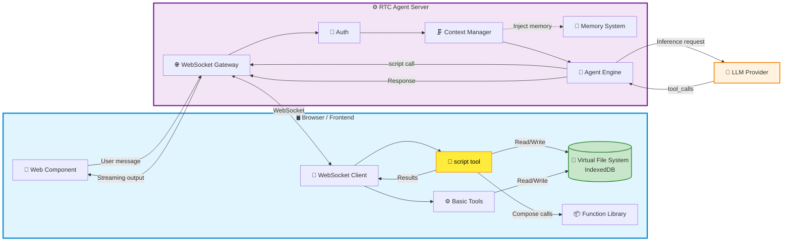
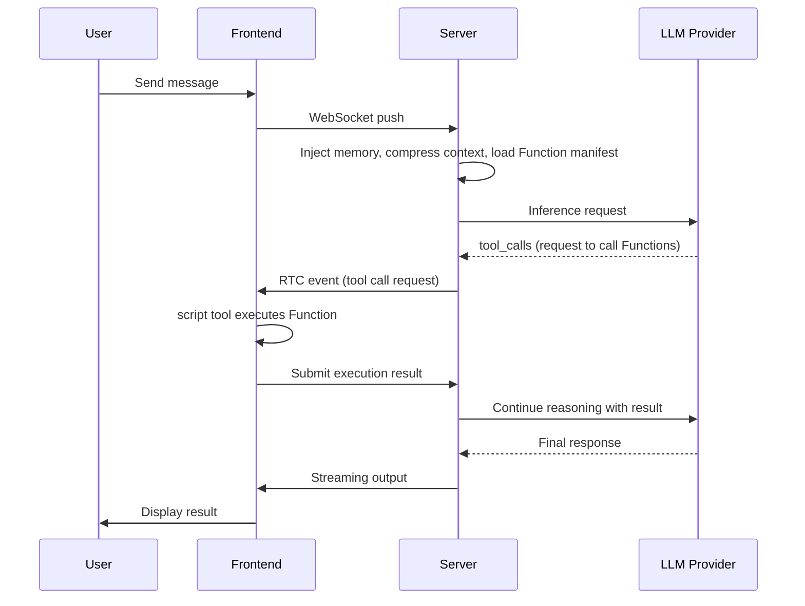

# 🤖 RTC Agent

[English](./README.md) | [中文](./README-ZH.md)


## **Remote Tool Calling — Integrate AI Assistant into Your Website with 3 Lines of Code**

Not screenshot recognition, not DOM crawling. AI operates websites directly through frontend tools — every step transparent and observable.

---

> **One-liner**: An open-source website AI assistant backend. Integrate a transparent, efficient, and cost-effective AI assistant into your website with just a few lines of code via the standardized Remote Tool Calling protocol.

RTC Agent lets AI reason on the server while **tools execute on the frontend** — reading page content, operating a virtual file system, calling business APIs — all synchronized in real-time over WebSocket, fully visible to your users.


## 🎯 Who Should Use RTC Agent?

- **SaaS product teams**: Want to add an AI assistant to their product without restructuring the backend
- **Frontend developers**: Want to quickly integrate AI capabilities, focusing on business logic rather than AI infrastructure
- **Privacy-sensitive applications**: Healthcare, finance, enterprise internal tools — where data cannot leave the user's device

---

## ✨ Core Capabilities

### 📂 Frontend Virtual File System

Built on **IndexedDB**, AI tools (`read` / `write` / `ls` / `grep`) operate directly on frontend files. Data never leaves the user's browser.

### 🔑 Script Tool + Function Composition

Developers **only need to maintain their own Function library**. The Agent executes them on the frontend via the `script` tool and can **freely combine multiple Functions** to accomplish complex tasks — no predefined workflows needed.

> 💡 **Developer's perspective**: You just define your business atomic capabilities (Functions), and the Agent learns how to combine them on its own. It's like giving AI a set of LEGO bricks — it figures out how to build what you want.

### 💬 Real-Time Communication

Built on **Centrifuge WebSocket**, with bidirectional message pushing, supporting streaming output, tool call progress, and state synchronization.

### 🧠 Memory System

Dual-layer memory: **Session Memory** (conversation context compression) + **User Memory** (cross-session long-term memory with vector retrieval). AI truly "remembers" your users.

### 🗜️ Context Management

Automatically compresses long conversations, keeping token consumption under control. Say goodbye to "context length exceeded" errors.

### 🤖 Sub-Agents + 🎯 Goal-Driven Execution

Complex tasks are automatically decomposed, with multiple specialized sub-agents working in parallel. AI sets, tracks, and completes multi-step goals, with turn-boundary checkpoints ensuring no task is lost.

---

## 🏗️ Architecture



Core data flow:

1. All **Function and file data** live in the browser's IndexedDB — the server never touches business data
2. The Agent Engine sends tool calls to the browser via the RTC protocol; the browser executes and returns results
3. Memory and context management run on the server, optimizing conversation quality

---

## 🔄 How It Works



### 🔑 Key Differences

| | Traditional Approach | RTC | RTC + Function |
| --- | --------- | ----- | ---------------- |
| **Tool execution location** | Server-side ❌ | Frontend ✅ | Frontend ✅ |
| **Data flow** | Uploaded to cloud 🔒 | Stays on user device 🔐 | Stays on user device 🔐 |
| **Extension method** | Modify server code | Define frontend tools | **Just define Functions; the Agent learns to compose them** |

---

## 📊 Comparison with Other AI Assistant Solutions

| Solution | Integration Cost | Observability | Token Cost | Error Rate | Privacy & Security |
| :----: | :-------: | :-------: | :---------: | :-----: | :-------: |
| **RTC Agent** | Low — a few lines of code | Fully transparent | Low | Low | Data stays on frontend |
| Visual Parsing (Screenshot + OCR) | Medium | Black box | Very high | Relatively high | Requires uploading screenshots |
| DOM Crawling (Server-side parsing) | Complex | Partially visible | Medium | Medium | Data uploaded to cloud |
| Browser Extension | Requires installation | Good | Medium | Medium | Runs locally |

> Every solution has its place: visual parsing works well for legacy systems with zero modification, and browser extensions suit offline scenarios. RTC Agent's advantage is — **no installation, no screenshots, no server-side changes** — just a few lines of code to let AI understand and operate your website in a structured way.

---

## 📦 Workspace Structure

This is a **pnpm monorepo** with the following packages:

| Package | Description | Tech Stack |
| --- | --- | --- |
| [`@rtc-agent/component`](./packages/component) | Core Web Components | Lit, Vite |
| [`@rtc-agent/client`](./packages/client) | Communication layer | Centrifuge WebSocket |
| [`@rtc-agent/protocol`](./packages/protocol) | Protocol type definitions | TypeScript |
| [`@rtc-agent/worker`](./packages/worker) | SharedWorker layer | Comlink |
| [`@rtc-agent/persistence`](./packages/persistence) | Local persistence layer | IndexedDB, Dexie.js |
| [`@rtc-agent/admin-ui`](./packages/admin-ui) | Admin console | React, Ant Design Pro, Umi Max |

### Package Dependencies

```text
component (main package)
├── client (communication)
├── protocol (types)
├── worker (background thread)
│   ├── client
│   ├── protocol
│   └── persistence
└── persistence (IndexedDB)
    ├── client
    └── protocol

admin-ui (standalone React app)
├── component
├── client
└── protocol
```

### pnpm Overrides

The root `package.json` includes `pnpm.overrides` to enforce consistent versions across all packages:

- **vitest** and related packages: Ensures all tests use the same version, preventing inconsistent test behavior
- **typescript**: Guarantees consistent compilation behavior across all packages

These overrides are managed centrally to avoid version conflicts and ensure reproducible builds.

---

## 🛠️ Development Setup

### Prerequisites

- **Node.js**: >= 22.0.0 (recommended: 24.21.0)
- **pnpm**: >= 8.0.0

### Installing Node.js

We recommend using [nvm](https://github.com/nvm-sh/nvm) to manage Node.js versions:

```bash
# Install the correct Node.js version
nvm install

# Use the correct Node.js version
nvm use
```

The recommended version is specified in the `.nvmrc` file.

### Installing Dependencies

```bash
# Install pnpm if you haven't already
npm install -g pnpm

# Install project dependencies
pnpm install
```

---

## 🚀 Development Commands

### Root-level Commands

```bash
# Build all packages (with turbo cache)
pnpm build

# Development mode (component only)
pnpm dev

# Type check all packages
pnpm typecheck

# Lint all packages
pnpm lint

# Run tests
pnpm test

# Format code
pnpm format
```

### Single Package Commands

```bash
cd packages/<package-name>

# Build
pnpm run build

# Development
pnpm run dev

# Type check
pnpm run typecheck

# Lint
pnpm run lint

# Test
pnpm run test
```

### admin-ui Special Commands

The `admin-ui` package uses Umi Max instead of turbo:

```bash
cd packages/admin-ui

# Development server
pnpm run dev

# Build (Umi Max)
pnpm run build

# Lint (Biome + tsc)
pnpm run lint
```

---

## 🧪 Testing Strategy

- **Unit Tests**: Vitest for all packages
- **Integration Tests**: Some packages have `*.integration.test.ts` files
- **E2E Tests**: Playwright for `component` and `admin-ui`

Run all tests:

```bash
pnpm test
```

Run E2E tests:

```bash
pnpm test:e2e
```

---

## 🏗️ Build Process

The build process is orchestrated by **Turborepo** with the following characteristics:

1. **Dependency-aware**: Packages are built in topological order
2. **Cached**: Turborepo caches build outputs (`.turbo` directory)
3. **Parallel**: Independent packages build in parallel

Build outputs:

- Most packages: `dist/` directory with TypeScript declarations
- `component`: Vite bundle + TypeScript declarations
- `admin-ui`: Umi Max production build

---

## 📝 Contributing

### Code Style

- Use **Biome** for formatting and linting (`pnpm format`, `pnpm lint`)
- TypeScript strict mode enabled
- No `any` types allowed

### Commit Convention

We use **Conventional Commits**:

```text
<type>(<scope>): <subject>

<body>

<footer>
```

Examples:

```text
feat(component): add dark mode support

Implement theme switching with CSS variables.

Co-Authored-By: Claude Code <noreply@anthropic.com>
```

```text
fix(client): reconnect on WebSocket timeout
```

### Pull Request Process

1. Create a feature branch from `dev`
2. Make your changes
3. Run `pnpm lint` and `pnpm test` to ensure quality
4. Commit with conventional commit message
5. Push and create PR to `dev` branch
6. Wait for review

---

## 🔧 Troubleshooting

### Build Failures

```bash
# Clean cache and reinstall
rm -rf node_modules .turbo
pnpm install

# Rebuild
pnpm build
```

### admin-ui Development Server Issues

```bash
cd packages/admin-ui

# Remove Umi cache
rm -rf src/.umi src/.umi-production

# Restart
pnpm run dev
```

### Type Check Failures

```bash
# Check specific errors
pnpm typecheck

# Or run tsc directly
pnpm tsc --noEmit
```

---

## 📚 Documentation

- [Getting Started](https://rtc-agent.github.io/docs/en/getting-started/) — Integrate RTC Agent in 5 minutes
- [Core Concepts](https://rtc-agent.github.io/docs/en/concepts/) — Deep dive into the RTC protocol and virtual file system
- [Integration Guide](https://rtc-agent.github.io/docs/en/integration/) — Learn how to register Functions and write Scenarios
- [Workspace Guide](./WORKSPACE.md) — Detailed monorepo structure and toolchain
- [Package Documentation](./packages/) — Individual package READMEs

---

## 🚀 Next Steps

- [Getting Started](https://rtc-agent.github.io/docs/en/getting-started/) — Integrate RTC Agent in 5 minutes
- [Core Concepts](https://rtc-agent.github.io/docs/en/concepts/) — Deep dive into the RTC protocol and virtual file system
- [Integration Guide](https://rtc-agent.github.io/docs/en/integration/) — Learn how to register Functions and write Scenarios

---

### 📄 License

[MIT License](./LICENSE)

Made with ❤️ by RTC Agent Team
